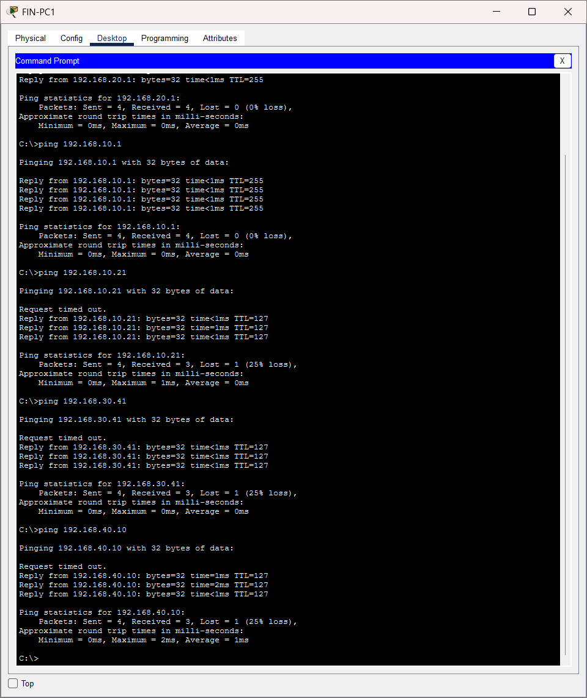
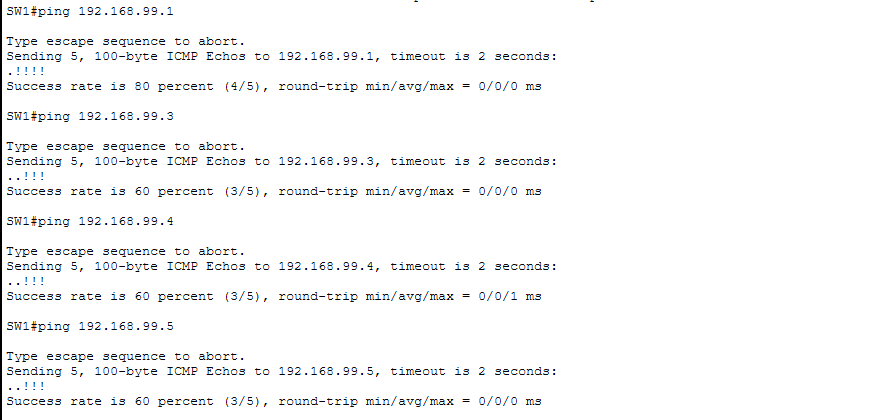

# Cisco Enterprise Network Security Lab

**Cisco Packet Tracer | Network Engineering | Cybersecurity**

## Overview

A hands-on enterprise networking project focused on designing, configuring, securing, and troubleshooting a simulated corporate network using Cisco Packet Tracer.

The network supports Human Resources, Finance, IT, and Server environments, with dedicated VLANs, inter-VLAN routing, and a separate management network.

This project demonstrates practical networking skills while progressively implementing enterprise security controls.

## Network Topology

**Infrastructure:**
- 1 Cisco PT8200 Router
- 4 Cisco 2960 Switches
- 6 Workstations
- 1 Server

## Technologies & Skills

`Cisco IOS` `VLANs` `802.1Q Trunking` `IPv4 Subnetting` `Inter-VLAN Routing` `Router-on-a-Stick` `SVIs` `Network Troubleshooting`

## Network Architecture

| VLAN | Department | Subnet |
|---|---|---|
| 10 | Human Resources | 192.168.10.0/24 |
| 20 | Finance | 192.168.20.0/24 |
| 30 | IT | 192.168.30.0/24 |
| 40 | Servers | 192.168.40.0/24 |
| 99 | Management | 192.168.99.0/24 |

The router provides inter-VLAN routing through 802.1Q subinterfaces, while the switches provide departmental connectivity and dedicated management interfaces.

## Implementation & Progress

### Milestone 1 — Network Foundation ✅

- Designed and built the enterprise network topology.
- Configured Ethernet connections and static IPv4 addressing.
- Established departmental networks and verified initial connectivity.

### Milestone 2 — VLANs & Inter-VLAN Routing ✅

- Configured five VLANs for departmental segmentation and network management.
- Implemented 802.1Q trunking between switches and the router.
- Configured router-on-a-stick for inter-VLAN communication.
- Established VLAN 99 for dedicated switch management.
- Verified routing tables, interface status, and network connectivity.

### Configuration & Testing Evidence

**VLAN Configuration**

**802.1Q Trunking**

**Inter-VLAN Connectivity**

**Management VLAN Connectivity**

Additional configuration screenshots are available in the repository.

## Troubleshooting Experience

During implementation, I diagnosed and resolved a VLAN trunk mismatch that caused spanning-tree inconsistencies and disrupted connectivity.

I also practiced troubleshooting default gateway configurations and migrated switch management from VLAN 1 to a dedicated management VLAN.

These experiences reinforced the importance of systematic troubleshooting, configuration verification, and understanding Layer 2 versus Layer 3 communication.

## Project Roadmap

- [x] **Milestone 1:** Network Foundation
- [x] **Milestone 2:** VLANs & Inter-VLAN Routing
- [ ] **Milestone 3:** Network Security Hardening (SSH, ACLs, Port Security)
- [ ] **Milestone 4:** Network Services & Monitoring
- [ ] **Milestone 5:** Security Validation & Final Documentation

## Next Steps

Milestone 3 will focus on implementing security controls to restrict unauthorized access, protect network infrastructure, and enforce communication policies between departments.

---

*This is an independent educational project built in Cisco Packet Tracer to develop practical networking and cybersecurity skills.*
